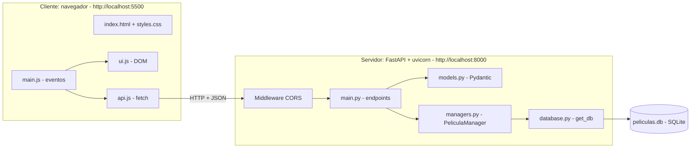
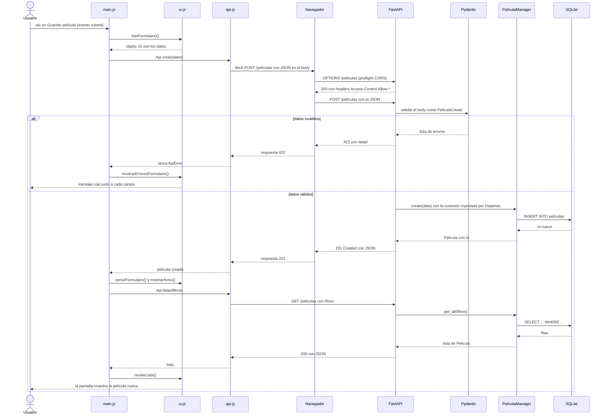
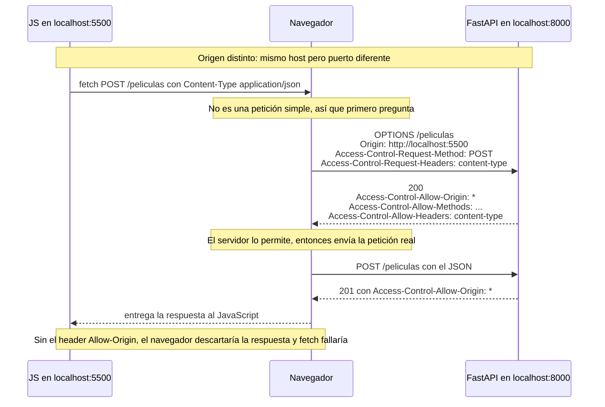

# Cartelera — App Full Stack de películas

Alumno: Gabriel Mileo — Curso: 6to5ta
Materia: Laboratorio de Programación — TP Evaluativo LPR3 (G1)

## 1. Descripción del tema

**Cartelera** es un catálogo personal de películas. Permite cargar las películas que ya vi o que quiero ver, calificarlas y buscarlas por texto, género, año de estreno, calificación mínima y estado (vista / pendiente).

La entidad principal es **Película**, con 9 campos:

| Campo | Tipo | Obligatorio | Regla de validación |
|---|---|---|---|
| `id` | entero | (lo genera la base) | autoincremental |
| `titulo` | texto | sí | 1 a 150 caracteres, sin espacios sobrantes |
| `director` | texto | sí | 1 a 100 caracteres |
| `genero` | texto | sí | uno de la lista de `/generos` (Acción, Drama, Terror…) |
| `anio` | entero | sí | desde 1888 hasta el año actual + 5 |
| `duracion_min` | entero | sí | mayor a 0 y hasta 600 |
| `calificacion` | decimal | no (vale 0) | entre 0 y 10 |
| `vista` | booleano | no (vale `false`) | `true` / `false` |
| `sinopsis` | texto | no | hasta 1000 caracteres |

## 2. Tecnologías usadas

- **Python 3.10+** — lenguaje del backend.
- **FastAPI** — framework para armar la API REST; genera la documentación interactiva sola y usa los tipos de Python para validar.
- **Uvicorn** — servidor que ejecuta la app FastAPI.
- **Pydantic** — define los modelos y valida los datos que llegan en el body y en los query params.
- **SQLite (módulo `sqlite3`)** — base de datos en un archivo (`peliculas.db`), sin instalar nada aparte.
- **HTML + CSS + JavaScript Vanilla** — frontend sin frameworks ni librerías. Usa `fetch` para hablar con la API, `<dialog>` para los formularios y `textContent` para dibujar los datos.

## 3. Instalación y ejecución (paso a paso)

Requisito: tener Python 3.10 o superior.

### Backend

```bash
cd backend
python -m venv venv
source venv/bin/activate          # Windows: venv\Scripts\activate
pip install -r requirements.txt
uvicorn main:app --reload
```

La API queda en **http://localhost:8000**. Al arrancar por primera vez crea `peliculas.db` con 12 películas de ejemplo.

### Frontend

En **otra terminal**:

```bash
cd frontend
python -m http.server 5500
```

Abrir **http://localhost:5500**. (También sirve la extensión Live Server de VS Code.) Si el backend corre en otra dirección, se cambia la constante `BASE_URL` al principio de `frontend/js/api.js`.

### Documentación interactiva de la API

FastAPI genera la documentación automáticamente:

- **Swagger UI:** http://localhost:8000/docs (permite probar cada endpoint desde el navegador)
- **ReDoc:** http://localhost:8000/redoc

## 4. Endpoints

| Método | Ruta | Descripción | Éxito | Errores |
|---|---|---|---|---|
| GET | `/peliculas` | Lista películas, con filtros opcionales | 200 | 422 (query inválido) |
| GET | `/peliculas/{id}` | Devuelve una película | 200 | 404 |
| POST | `/peliculas` | Crea una película | 201 | 422 |
| PUT | `/peliculas/{id}` | Actualiza (solo los campos enviados) | 200 | 404, 422 |
| DELETE | `/peliculas/{id}` | Elimina | 204 (sin cuerpo) | 404 |
| GET | `/generos` | Lista de géneros válidos | 200 | — |

### Filtros de `GET /peliculas` (query string)

| Parámetro | Tipo | Significado |
|---|---|---|
| `q` | texto | el título **o** el director contienen este texto |
| `genero` | texto | género exacto |
| `anio_min` / `anio_max` | entero | **rango numérico** de año de estreno |
| `calificacion_min` | decimal 0–10 | calificación mínima |
| `vista` | `true` / `false` | vistas o pendientes |

Se pueden combinar: `GET /peliculas?genero=Crimen&anio_min=1990&calificacion_min=8`

### Ejemplos de request / response

**Listar con filtros**

```http
GET /peliculas?genero=Crimen&anio_min=1990
```
```json
[
  {
    "titulo": "Nueve reinas", "director": "Fabián Bielinsky", "genero": "Crimen",
    "anio": 2000, "duracion_min": 114, "calificacion": 7.9, "vista": true,
    "sinopsis": "Dos estafadores se asocian por un día para vender una falsificación valiosa.",
    "id": 6
  },
  {
    "titulo": "Pulp Fiction", "director": "Quentin Tarantino", "genero": "Crimen",
    "anio": 1994, "duracion_min": 154, "calificacion": 8.9, "vista": true,
    "sinopsis": "Historias cruzadas de delincuentes en Los Ángeles, contadas fuera de orden.",
    "id": 2
  }
]
```

**Crear** — `POST /peliculas` → `201 Created`

```json
{ "titulo": "Mad Max: Furia en el camino", "director": "George Miller",
  "genero": "Acción", "anio": 2015, "duracion_min": 120 }
```
```json
{ "titulo": "Mad Max: Furia en el camino", "director": "George Miller",
  "genero": "Acción", "anio": 2015, "duracion_min": 120,
  "calificacion": 0.0, "vista": false, "sinopsis": null, "id": 13 }
```

**Actualizar** — `PUT /peliculas/13` → `200 OK` (solo cambia lo enviado)

```json
{ "calificacion": 8.3, "vista": true }
```

**No existe** — `GET /peliculas/9999` → `404 Not Found`

```json
{ "detail": "No existe la película con id 9999" }
```

**Datos inválidos** — `POST /peliculas` → `422 Unprocessable Entity`

```json
{ "titulo": "", "director": "X", "genero": "Otro", "anio": 1500, "duracion_min": -3 }
```
```json
{
  "detail": [
    { "type": "string_too_short", "loc": ["body", "titulo"],
      "msg": "String should have at least 1 character" },
    { "type": "literal_error", "loc": ["body", "genero"],
      "msg": "Input should be 'Acción', 'Animación', 'Aventura', ..." },
    { "type": "greater_than_equal", "loc": ["body", "anio"],
      "msg": "Input should be greater than or equal to 1888" },
    { "type": "greater_than", "loc": ["body", "duracion_min"],
      "msg": "Input should be greater than 0" }
  ]
}
```

(La respuesta real de FastAPI incluye además `input` y `ctx` en cada error; se omitieron para abreviar.)

**Eliminar** — `DELETE /peliculas/13` → `204 No Content` (cuerpo vacío)

## 5. Estructura del proyecto

```
tp-fullstack-<apellido>/
├── README.md
├── backend/
│   ├── main.py           app FastAPI, CORS y endpoints
│   ├── models.py         modelos Pydantic (Base, Create, Update, respuesta)
│   ├── managers.py       PeliculaManager: todo el SQL
│   ├── database.py       conexión (get_db), esquema y datos de ejemplo
│   └── requirements.txt
├── frontend/
│   ├── index.html
│   ├── css/styles.css
│   └── js/
│       ├── api.js        único lugar con fetch
│       ├── ui.js         manipulación del DOM
│       └── main.js       eventos y orquestación
└── docs/                 capturas de pantalla
```

## 6. Diagramas

### 6.1 Arquitectura general



### 6.2 Secuencia de una petición POST (clic en "Guardar película")



### 6.3 Flujo CORS



## 7. Capturas de pantalla

_(Guardar las capturas en `docs/` y enlazarlas acá.)_


## 8. Preguntas de arquitectura cliente-servidor

### Pregunta 1 — El ciclo de vida de una petición

El diagrama de la sección 6.2 muestra el recorrido. Paso a paso, cuando hago clic en **Guardar película**:

1. El navegador dispara el evento `submit` del formulario. En `main.js` el handler llama a `preventDefault()` para que la página no se recargue.
2. `main.js` le pide a `ui.js` que lea los campos (`leerFormulario()`), que devuelve un objeto JavaScript. Los números vacíos se convierten en `null` y los demás con `Number()`.
3. `main.js` llama a `Api.crear(datos)`. Ahí, en `api.js`, se convierte el objeto a texto JSON con `JSON.stringify` y se ejecuta `fetch` con método POST y el header `Content-Type: application/json`.
4. Como el frontend (puerto 5500) y la API (puerto 8000) son orígenes distintos, el navegador antes hace una petición **OPTIONS** (preflight) para preguntar si el servidor lo permite. El middleware CORS responde que sí.
5. Recién ahí el navegador envía el **POST** real al servidor.
6. FastAPI recibe la petición, encuentra el endpoint `crear_pelicula` y Pydantic convierte el JSON en un objeto `PeliculaCreate`, validando cada campo. Si algo falla, responde **422** sin ejecutar mi código (esa rama vuelve por `ApiError` hasta `ui.js`, que pinta el error rojo junto al campo).
7. Si los datos son válidos, FastAPI resuelve las dependencias: `get_db` abre la conexión a SQLite y `get_manager` crea un `PeliculaManager` con esa conexión.
8. El endpoint llama a `manager.create(data)`. El manager ejecuta el `INSERT` con parámetros (`?`), hace `commit`, lee la fila recién creada y la devuelve.
9. FastAPI serializa la película a JSON y responde **201 Created**. Al terminar el request, `get_db` cierra la conexión (el `finally`).
10. La respuesta vuelve al navegador, `api.js` la convierte con `respuesta.json()` y `main.js` recibe la película creada.
11. `main.js` cierra el formulario, muestra el aviso «Película guardada» y vuelve a pedir la lista con `Api.listar(filtrosActuales)` (un GET a `/peliculas`), respetando los filtros que estaban aplicados.
12. `ui.js` recibe la lista y redibuja las tarjetas: la película nueva aparece en pantalla.

### Pregunta 2 — ¿Quién es el cliente y quién es el servidor?

- **Cliente:** el navegador, que ejecuta `index.html`, `styles.css` y los tres archivos JS. Es quien **inicia** las peticiones y muestra los resultados al usuario.
- **Servidor:** el proceso de **uvicorn** ejecutando la app FastAPI (`main.py`). Espera peticiones HTTP, aplica las reglas (validación, filtros) y accede a los datos.
- **Base de datos:** `peliculas.db` es un archivo SQLite. No es un servidor aparte: lo abre el servidor FastAPI cuando lo necesita. El cliente nunca la toca directamente.

El diagrama de la sección 6.1 muestra la arquitectura.

**Diferencia con una aplicación de escritorio tradicional:** en una app de escritorio, la interfaz, la lógica y los datos viven juntos en un mismo programa y en una misma computadora. En el modelo cliente-servidor las partes están **separadas** y se comunican por la red con un protocolo (HTTP). Eso trae varias consecuencias: los datos están en un solo lugar y varios clientes distintos (otro navegador, una app de celular) pueden usar la misma API; si cambio una regla en el servidor, todos los clientes la reciben sin reinstalar nada; y a cambio hay que manejar cosas que en escritorio no existen, como que la red falle o que el servidor esté caído (por eso mi frontend muestra un mensaje de error de conexión).

### Pregunta 3 — HTTP como lenguaje común

**Métodos HTTP:** indican qué quiere hacer el cliente con un recurso.

- `GET`: leer datos, sin modificar nada.
- `POST`: crear un recurso nuevo.
- `PUT`: actualizar un recurso existente.
- `DELETE`: eliminar un recurso.

**Códigos de estado:** son el resultado que devuelve el servidor, agrupados por familia. `2xx` significa que salió bien (`200 OK`, `201 Created`, `204 No Content`), `4xx` que el error fue del cliente (`404 Not Found`, `422 Unprocessable Entity`) y `5xx` que falló el servidor.

| Operación | Método | Ruta | Código de éxito | Código de error |
|---|---|---|---|---|
| Listar / filtrar | GET | `/peliculas` | 200 OK | 422 si un parámetro es inválido (ej. `anio_min=abc`) |
| Obtener una | GET | `/peliculas/{id}` | 200 OK | 404 si el id no existe |
| Crear | POST | `/peliculas` | 201 Created | 422 si el body no cumple el modelo |
| Actualizar | PUT | `/peliculas/{id}` | 200 OK | 404 si no existe; 422 si los datos son inválidos |
| Eliminar | DELETE | `/peliculas/{id}` | 204 No Content | 404 si no existe |
| Listar géneros | GET | `/generos` | 200 OK | — |

**Por qué cada código:** el POST devuelve **201** (y no 200) porque se creó un recurso nuevo. El DELETE devuelve **204** porque no hay nada que mostrar: la película ya no existe, así que la respuesta no tiene cuerpo. Devuelvo **404** cuando el id no existe porque el recurso pedido no se encuentra, y **422** cuando la petición llegó bien formada como HTTP pero los datos no cumplen las reglas (título vacío, año 1500, etc.).

### Pregunta 4 — CORS

**SOP (Same-Origin Policy):** es una regla de seguridad del navegador. Un **origen** se define por tres cosas: protocolo + dominio + puerto. Mi frontend está en `http://localhost:5500` y mi API en `http://localhost:8000`: el puerto es distinto, así que son **orígenes distintos**. Por defecto, el navegador no le deja al JavaScript de un origen leer las respuestas de otro origen.

**Por qué existe:** imaginemos que estoy logueado en mi banco en una pestaña y abro en otra una página maliciosa. Sin SOP, el JavaScript de esa página podría hacer peticiones al banco con mi sesión y leer mis datos. Con SOP, el navegador lo impide. El bloqueo lo hace el **navegador**, no el servidor.

**Qué hace el middleware CORS:** CORS es el mecanismo que permite al **servidor** decir explícitamente «acepto que ese otro origen me consulte». Lo hace agregando headers a sus respuestas (`Access-Control-Allow-Origin`, `-Methods`, `-Headers`). El `CORSMiddleware` que configuré en `main.py` agrega esos headers a todas las respuestas y contesta automáticamente los preflight `OPTIONS`.

En mi app, los `POST`, `PUT` y `DELETE` y cualquier petición con `Content-Type: application/json` disparan el preflight, porque no son «peticiones simples». Un `GET` sin headers especiales no lo dispara; por eso en `api.js` el header `Content-Type` solo se agrega cuando hay body.

Puse `allow_origins=["*"]` para simplificar el desarrollo. En producción debería ser solo el origen real del frontend. El diagrama del flujo está en la sección 6.3.

### Pregunta 5 — Separación de responsabilidades

**Por qué separar el Manager de los endpoints:** cada pieza tiene un solo trabajo. El endpoint se ocupa de HTTP (recibir la petición, elegir el código de estado, devolver 404). El manager se ocupa de los datos (SQL, filtros, transacciones). Los beneficios: los endpoints quedan cortos y legibles; si cambio de SQLite a otra base, solo modifico `managers.py`; y el manager se puede probar sin levantar un servidor web.

**Beneficios de inyectar la conexión con `Depends(get_db)`:**

- La conexión se abre y se cierra en **un solo lugar** (el `try/finally` de `get_db`), así que no me puedo olvidar de cerrarla, ni siquiera cuando hay una excepción.
- El manager recibe la conexión por el constructor y no sabe de dónde viene: se podría inyectar una base en memoria para tests.
- Cada request obtiene su **propia** conexión, así que dos usuarios simultáneos no se pisan.

**Qué pasaría si abriera una conexión nueva por cada línea de código:** habría muchas conexiones abiertas por request, lo que es lento y desperdicia recursos; sería fácil dejar alguna sin cerrar (fuga de conexiones); y, en SQLite, varias conexiones escribiendo a la vez pueden dar el error `database is locked`. Además cada conexión tendría su propia transacción, por lo que no podría garantizar que dos operaciones relacionadas se guarden juntas o ninguna. Y el código quedaría lleno de repeticiones.

### Pregunta 6 — JSON como formato de intercambio

**Por qué JSON:** es un formato de texto simple, legible por personas, que **cualquier lenguaje** puede leer y escribir. El frontend está en JavaScript y el backend en Python; JSON es el idioma neutral entre ambos. Además JavaScript lo entiende de forma nativa (`JSON.stringify` / `response.json()`), y es más liviano que alternativas como XML.

**Cómo procesa Pydantic el body:** FastAPI lee el texto JSON, lo convierte a un diccionario de Python y Pydantic lo transforma en un objeto `PeliculaCreate`, revisando cada campo contra el modelo: tipo (`anio` debe ser entero), rango (`calificacion` entre 0 y 10), largo del texto, valores permitidos (`genero`). También limpia los espacios sobrantes de los textos. Si algo no cumple, el endpoint **no se ejecuta** y se responde 422.

**Qué garantiza la validación:** que dentro del endpoint y del manager los datos ya son correctos y del tipo esperado, así que a la base nunca llega un año negativo o un título vacío. También evita que el cliente mande campos con tipos equivocados.

**Ejemplo de request inválido:**

```http
POST /peliculas
Content-Type: application/json

{ "titulo": "", "director": "Nolan", "genero": "Drama", "anio": 1500, "duracion_min": 120 }
```

**Respuesta del servidor (`422 Unprocessable Entity`):**

```json
{
  "detail": [
    { "type": "string_too_short", "loc": ["body", "titulo"],
      "msg": "String should have at least 1 character" },
    { "type": "greater_than_equal", "loc": ["body", "anio"],
      "msg": "Input should be greater than or equal to 1888" }
  ]
}
```

Cada error indica **dónde** (`loc`) y **qué** pasó (`msg`). El frontend usa `loc` para saber en qué campo mostrar cada mensaje.

### Pregunta 7 — Statelessness (sin estado)

**Qué significa:** que cada petición HTTP es independiente y trae toda la información necesaria para ser atendida. El servidor no «recuerda» las peticiones anteriores. Por ejemplo, `GET /peliculas?genero=Crimen` incluye en sí misma el filtro; el servidor no necesita saber qué pedí antes.

**Dónde queda el estado en mi proyecto:** los **datos** (las películas) están en la base SQLite, en el archivo `peliculas.db`. Los filtros que están aplicados en pantalla los guarda el **frontend** en una variable de `main.js` (`filtrosActuales`) y los reenvía en cada consulta. El servidor FastAPI no guarda nada en memoria entre peticiones (cada request abre y cierra su propia conexión).

**Ventaja si mañana hubiera 3 servidores en lugar de 1:** como ningún servidor guarda información de sesión, **cualquiera de los tres puede atender cualquier petición**: un balanceador de carga podría repartir las peticiones sin importar a cuál tocó la anterior. Si uno se cae, los otros siguen funcionando. Es lo que permite escalar horizontalmente.

**Una salvedad:** para que eso funcione en mi proyecto, tendría que reemplazar SQLite por una base de datos que los tres servidores compartan por red (por ejemplo PostgreSQL). Con SQLite cada servidor tendría su propio archivo y verían datos distintos.

## 9. Criterios de diseño

- **Manager separado del endpoint.** Los endpoints no tienen SQL; todo está en `PeliculaManager`. Se cumple el requisito y además facilita cambiar de base de datos.
- **Conexión inyectada en dos pasos:** `get_db` (abre/cierra la conexión) y `get_manager` (arma el manager con esa conexión). Los endpoints solo piden `Depends(get_manager)`.
- **Consultas parametrizadas.** Todos los valores del usuario se pasan con `?`, nunca concatenados en el SQL, para evitar inyección SQL. En la búsqueda de texto también se escapan `%` y `_`.
- **Validación con Pydantic, en un solo lugar.** Las reglas viven en `models.py`. El modelo de actualización tiene todos los campos opcionales y solo se modifican los que llegan (`exclude_unset`). Un campo obligatorio no puede enviarse como `null`.
- **Filtros combinables.** Hay seis filtros que se aplican con `AND`, incluido el rango numérico `anio_min` / `anio_max`.
- **`GET /generos`.** La lista de géneros válidos se define solo en el backend y el frontend la pide; así no hay dos listas que puedan quedar desincronizadas.
- **Frontend en tres capas:** `api.js` (único que usa `fetch`), `ui.js` (único que toca el DOM) y `main.js` (conecta eventos con las otras dos).
- **Los formularios usan `novalidate`.** Desactivé la validación nativa del navegador a propósito para que las reglas las aplique el backend (fuente única de la verdad) y se vean los errores 422 reales.
- **Un solo tipo de error en el frontend (`ApiError`)** para respuestas 404/422 y para fallas de red, así el resto del código las trata de la misma forma.
- **Seguridad en el DOM.** Los datos se insertan con `textContent`, no con `innerHTML`, para que un título como `<script>…` se muestre como texto y no se ejecute.
- **Estados de la interfaz:** carga (indicador y botón deshabilitado), lista vacía, error de red con botón «Reintentar», guardando y confirmación antes de borrar (con `<dialog>`).
- **Scripts clásicos y no módulos ES**, para que el frontend funcione también si se abre con Live Server o un servidor estático cualquiera.
- **SQLite con `check_same_thread=False`**, porque FastAPI puede abrir y cerrar la conexión en hilos distintos; cada request tiene su propia conexión, así que no se comparte entre requests.
- **Diseño visual:** cada película se muestra como una entrada de cine (talón ámbar con la calificación y cuerpo con los datos), con tipografía serif para los títulos, contraste alto, foco visible y adaptación a pantallas chicas.
